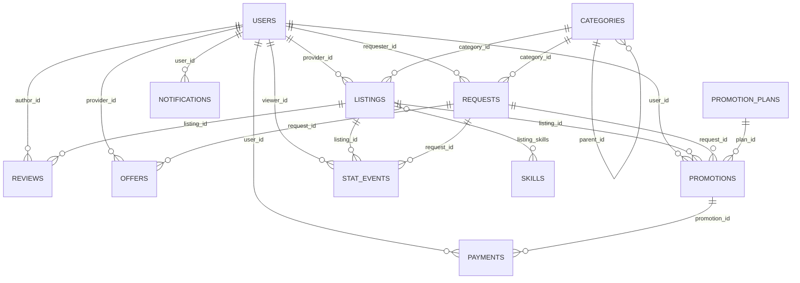

# Project Roadmap & AI Agent Codebase Map (`omulpotrivit`)

> **Purpose:** This document is a single-source-of-truth architectural map and file index for AI Agents and developers working on **Omul Potrivit**. Consult this map first to jump straight to the exact file, route, model, migration, controller, or view needed for a task without scanning the entire repository.

---

## 1. Project Overview & Tech Stack

- **Domain:** Service Marketplace Platform (*Omul Potrivit*) connecting service providers (`provider_id`) and clients (`requester_id`). Supports service listings, hierarchical categories, user reviews, admin moderation, and pre-built database models for service requests, offers, skills, promotion plans, payments, analytics (`stat_events`), and notifications.
- **Tech Stack:**
  - **Backend:** PHP `^8.2`, Laravel Framework `^12.0`
  - **Auth & API:** Laravel Breeze `^2.4` (session/web auth), Laravel Sanctum (`*`)
  - **Frontend:** Blade templates, Tailwind CSS (`tailwindcss ^3.1.0`, `@tailwindcss/forms ^0.5.2`, `@tailwindcss/vite ^4.0.0`), Alpine.js `^3.4.2`, Axios `^1.11.0`, Vite `^7.0.7`
  - **Database:** SQLite (`database/database.sqlite` configured in `.env.example`) or MySQL (`omulpotrivit_db` documented in `PASI_GENERARE_MODELE_ORM.md`)
  - **Testing & Tooling:** PHPUnit `^11.5.50`, Mockery `^1.6`, Laravel Pint `^1.24`, Laravel Pail `^1.2.2`, Laravel Sail `^1.41`
- **Architectural Pattern:** Multi-layered Laravel MVC extended with:
  - **Services Layer:** `app/Services/` (`ListingService`, `CategoryService`, `ReviewService`) handling business logic, quota enforcement, `Cache::remember`/`Cache::forget`, `Log::info`/`Log::warning`, and logical deletion.
  - **Data Access Layer (Accessors):** `app/Accessors/` (`CategoryAccessor`, `ListingAccessor`, `PromotionPlanAccessor`, `ReviewAccessor`) encapsulating Eloquent queries and CRUD/logical delete operations.
  - **ViewModels:** `app/ViewModels/ListingViewModel.php` formatting `Listing` models for Blade presentation.
  - **API Resources (DTO Mappers):** `app/Http/Resources/ListingResource.php` transforming `Listing` models into Romanian-keyed JSON payloads.

---

## 2. Quick Task-to-File Lookup ("Where to Look First")

| If you need to... | Go directly to | Notes / Key Symbols |
| :--- | :--- | :--- |
| Add or modify public/auth/admin web routes | `routes/web.php` | Public `/`, `/auth-required`; `auth` group; `admin` prefix group |
| Add or modify REST API endpoints | `routes/api.php`, `app/Http/Controllers/Api/ListingController.php` | Prefixed with `/api` via `bootstrap/app.php` |
| Modify auth routes (login/register/reset/verify) | `routes/auth.php`, `app/Http/Controllers/Auth/*` | Standard Laravel Breeze controllers |
| Change unauthenticated guest redirect target | `bootstrap/app.php` | `redirectGuestsTo(fn () => route('auth.required'))` |
| Modify listing browsing, creation, edit, or free-plan limits | `app/Http/Controllers/ListingController.php` | `index()`, `details()`, `myListings()`, `canUserCreateListing()`, `create()`, `store()`, `edit()`, `update()` |
| Modify listing DB queries / DAL methods | `app/Accessors/ListingAccessor.php` | `getAll()`, `getById()`, `getByCategoryId()`, `create()`, `update()`, `delete()`, `addEntity()`, `updateEntity()` |
| Modify category DB queries / DAL methods | `app/Accessors/CategoryAccessor.php` | `getAll()`, `getById()`, `create()`, `update()`, `delete()` |
| Modify listing display formatting in Blade views | `app/ViewModels/ListingViewModel.php` | Formats `priceFormatted`, `priceType`, `city`, `categoryName`, `isFeatured`, `status` |
| Modify JSON DTO output for `/api/listings` or JSON web responses | `app/Http/Resources/ListingResource.php` | Maps fields to Romanian keys (`titlu`, `descriere`, `pret_afisat`, etc.) |
| Modify review listing or submission | `app/Http/Controllers/ReviewController.php` | `index()`, `create()`, `store()` |
| Modify Admin Dashboard, User CRUD, Listing CRUD, Review moderation | `app/Http/Controllers/AdminController.php`, `app/Http/Middleware/AdminMiddleware.php` | Role check: `auth()->user()->role === 'admin'` |
| Modify user profile editing or deletion | `app/Http/Controllers/ProfileController.php`, `app/Http/Requests/ProfileUpdateRequest.php` | `edit()`, `update()`, `destroy()` |
| Inspect Eloquent models & relationships | `app/Models/*` | 13 models (`User`, `Listing`, `Category`, `Review`, etc.) |
| Inspect table columns, foreign keys & constraints | `database/migrations/*` | 19 migration files |
| Inspect or update seed users, categories, listings, tags | `database/seeders/DatabaseSeeder.php` | Seeds 3 users, 4 categories, 8 listings, 3 tags |
| Inspect ORM / Model generation notes | `PASI_GENERARE_MODELE_ORM.md` | Explains Active Record / Eloquent setup & `Accessors` |
| Update navigation bar or admin sub-nav | `resources/views/layouts/navigation.blade.php`, `resources/views/components/admin-nav.blade.php` | Top nav & Admin panel tabs/breadcrumbs |

---

## 3. Directory & File Inventory

### `app/`
- **`app/Accessors/`** (Data Access Layer)
  - `CategoryAccessor.php` — Eager-loads and manages CRUD for `Category` (`getAll()`, `getAllWithActiveListings()`, `getById()`, `create()`, `update()`, `delete()`).
  - `ListingAccessor.php` — Eager-loads and manages CRUD, active-only/featured-first queries, `countAll()`, user listing queries, and logical deletion (`softDelete()` setting `status = 'inactiv'`).
  - `PromotionPlanAccessor.php` — Manages read/CRUD queries for `PromotionPlan`.
  - `ReviewAccessor.php` — Manages visible (`is_hidden = false`) review queries and logical hiding (`setHidden()`, `toggleHidden()`).
  - `UserAccessor.php` — Manages `User` queries (`getAllWithListings()`, `getAll()`, `getById()`, `count()`) and CRUD.
- **`app/Services/`** (Business Logic, Cache, Logging & Logical Deletion)
  - `ListingService.php` — Injects `ListingAccessor` & `PromotionPlanAccessor`; caches home listings, active listings, and promotion plans (`Cache::remember` / `Cache::forget`); enforces free-plan quota (`canUserCreateListing`), promotion, logical deletion (`status = 'inactiv'`), `countAllListings()`, and logging (`Log::info` / `Log::warning`).
  - `CategoryService.php` — Injects `CategoryAccessor`; caches categories and active-listing categories with invalidation and logging.
  - `ReviewService.php` — Injects `ReviewAccessor`; filters `is_hidden = true` from public queries and logs review creation/moderation/logical hiding.
  - `UserService.php` — Injects `UserAccessor`; handles admin user creation (with password hashing), updates, self-deletion guard, and logging.
- **`app/Http/Controllers/`**
  - `Controller.php` — Base abstract controller.
  - `AdminController.php` — Admin dashboard stats, user management, listing management, and review moderation (`toggleReviewVisibility`, `destroyReview`).
  - `ListingController.php` — Web listing index/details (also returns `ListingResource` if `wantsJson()`), `myListings`, `create`/`store`, `edit`/`update`, and free-plan limit enforcement.
  - `ProfileController.php` — Breeze profile edit, update, and account deletion.
  - `ReviewController.php` — Paginated review listing (`index`) and review creation (`create`, `store`).
  - **`Api/ListingController.php`** — JSON REST API controller for `GET /api/listings`, `GET /api/listings/{id}`, `POST /api/listings`, `PUT /api/listings/{id}`.
  - **`Auth/*`** — Standard Laravel Breeze auth controllers: `AuthenticatedSessionController.php`, `ConfirmablePasswordController.php`, `EmailVerificationNotificationController.php`, `EmailVerificationPromptController.php`, `NewPasswordController.php`, `PasswordController.php`, `PasswordResetLinkController.php`, `RegisteredUserController.php`, `VerifyEmailController.php`.
- **`app/Http/Middleware/`**
  - `AdminMiddleware.php` — Allows request only if `auth()->check() && auth()->user()->role === 'admin'`; otherwise aborts with `403`.
- **`app/Http/Requests/`**
  - `ProfileUpdateRequest.php` — Validates `name` and unique lowercase `email` for profile updates.
  - `Auth/LoginRequest.php` — Breeze login validation & rate-limiting.
- **`app/Http/Resources/`**
  - `ListingResource.php` — JSON DTO transformer for `Listing`.
- **`app/Models/`**
  - `AppNotification.php`, `Category.php`, `Listing.php`, `Offer.php`, `Payment.php`, `Promotion.php`, `PromotionPlan.php`, `Review.php`, `ServiceRequest.php`, `Skill.php`, `StatEvent.php`, `Tag.php`, `User.php`.
- **`app/Providers/`**
  - `AppServiceProvider.php` — Default empty service provider (`register()`, `boot()`).
- **`app/View/Components/`**
  - `AppLayout.php` — Renders `layouts.app`.
  - `GuestLayout.php` — Renders `layouts.guest`.
- **`app/ViewModels/`**
  - `ListingViewModel.php` — Presentation wrapper around `Listing` for Blade views.

### `bootstrap/`
- `app.php` — Configures routing (`web.php`, `api.php`, `console.php`, health check `/up`), guest redirect (`auth.required`), and exceptions.
- `providers.php` — Registers `AppServiceProvider`.

### `routes/`
- `web.php` — Public, authenticated, and `/admin` routes.
- `api.php` — Sanctum `/api/user` and `/api/listings` CRUD routes.
- `auth.php` — Breeze guest & authenticated auth routes.
- `console.php` — Default `inspire` Artisan command.

### `database/`
- `migrations/` — 19 migrations (3 Laravel base tables, 12 domain/feature tables, 2 schema modification migrations, `personal_access_tokens`).
- `seeders/DatabaseSeeder.php` — Seeds initial users, categories, listings, and tags.
- `factories/UserFactory.php` — Standard user factory.
- `database.sqlite` — Local SQLite database file.

### `resources/`
- `css/app.css`, `js/app.js`, `js/bootstrap.js` — Frontend asset entry points.
- `views/` — Blade templates (see Section 7 for the full view map).

### `tests/`
- `TestCase.php`, `Unit/ExampleTest.php`, `Feature/ExampleTest.php`, `Feature/ProfileTest.php`, `Feature/Auth/*` (Breeze default test suite).

### Root Configuration & Docs
- `composer.json`, `package.json`, `vite.config.js`, `tailwind.config.js`, `postcss.config.js`, `phpunit.xml`, `.env.example`, `PASI_GENERARE_MODELE_ORM.md`, `README.md`.

---

## 4. Database Schema & Eloquent Models Map (13 Models + Pivot/Auth Tables)

### Entity-Relationship Diagram



### Active vs. Schema-Ready Models

#### A. Actively Used Models (Wired to Controllers, Routes & Views)

| Model (`app/Models/`) | Table | Mass-Assignable (`$fillable`) & Key Columns | Relationships | Notes |
| :--- | :--- | :--- | :--- | :--- |
| `User` | `users` | `name`, `email` (unique), `password` (hashed cast), `phone`, `city`, `avatarUrl`, `role` (default `'user'`, values `'user'`/`'admin'`) | `listings()` (`hasMany` via `provider_id`) | Uses `HasFactory`, `Notifiable` |
| `Category` | `categories` | `name` (unique), `description`, `parent_id` (nullable FK -> `categories.id`, `nullOnDelete`) | `subcategories()`, `parent()`, `listings()` | Recursive parent/child tree |
| `Listing` | `listings` | `provider_id`, `category_id`, `title`, `description` (`longText`), `price` (decimal 10,2), `priceType`, `city`, `imageUrl`, `status` (default `'activ'`), `views_count` (uint, default `0`), `is_featured` (bool, default `false`) | `provider()` (`belongsTo` User), `category()`, `skills()` (`belongsToMany` via `listing_skills`), `reviews()` | Core entity; `views_count` & `is_featured` added in `modify_listings_table` |
| `Review` | `reviews` | `listing_id`, `author_id`, `rating` (unsigned tinyInt), `comment`, `is_hidden` (bool, default `false`) | `listing()`, `author()` (`belongsTo` User) | DB unique constraint on `['listing_id', 'author_id']`; `is_hidden` added later |
| `Tag` | `tags` | `name`, `slug` (unique) | *None defined* | Seeded in `DatabaseSeeder` and read on `/laborator` |

#### B. Schema-Ready / Unwired Domain Models (Migrations & Models Exist, No Controllers/Routes Yet)

| Model (`app/Models/`) | Table | Mass-Assignable (`$fillable`) & Key Columns | Relationships | Notes |
| :--- | :--- | :--- | :--- | :--- |
| `ServiceRequest` | `requests` | `requester_id`, `category_id`, `title`, `description`, `budget` (unsigned decimal 10,2), `city`, `deadline` (date), `status` (default `'activ'`) | `requester()`, `category()`, `offers()` (`hasMany` via `request_id`) | Explicit `protected $table = 'requests';` |
| `Offer` | `offers` | `request_id`, `provider_id`, `message`, `proposedPrice` (decimal 10,2), `status` (default `'in_asteptare'`) | `request()` (`ServiceRequest`), `provider()` (`User`) | DB unique constraint on `['request_id', 'provider_id']` |
| `Skill` | `skills` | `name` (unique) | `listings()` (`belongsToMany` via `listing_skills`) | Uses composite PK pivot `listing_skills` |
| `PromotionPlan` | `promotion_plans` | `name`, `price`, `currency` (default `'RON'`), `durationDays` (uint), `maxItems` (nullable uint) | `promotions()` (`hasMany` via `plan_id`) | Pricing plans for paid promotions |
| `Promotion` | `promotions` | `plan_id`, `user_id`, `listing_id` (nullable), `request_id` (nullable), `startsAt`, `endsAt`, `status` (default `'PENDING'`) | `plan()`, `payment()` (`hasMany(Payment::class, 'promotion_id')`) | Links a plan/user to either a listing or request |
| `Payment` | `payments` | `user_id`, `promotion_id`, `amount` (unsigned decimal), `currency` (default `'RON'`), `method`, `status` (default `'PENDING'`), `providerRef`, `paidAt` | `promotion()` | Tracks Stripe/payment attempts for a `Promotion` |
| `StatEvent` | `stat_events` | `viewer_id` (nullable, `nullOnDelete`), `listing_id` (nullable), `request_id` (nullable), `eventType`, `searchQuery`, `resultPosition` | `viewer()` (`User`) | Impression/view/contact analytics events |
| `AppNotification` | `notifications` | `user_id`, `kind`, `message`, `isRead` (bool, default `false`) | `user()` | Explicit `protected $table = 'notifications';` |

#### C. Pivot & System Migrations (`database/migrations/`)
- `0001_01_01_000000_create_users_table.php` (`users`, `password_reset_tokens`, `sessions`)
- `0001_01_01_000001_create_cache_table.php` (`cache`, `cache_locks`)
- `0001_01_01_000002_create_jobs_table.php` (`jobs`, `job_batches`, `failed_jobs`)
- `2026_10_12_101510_create_listing_skills_table.php` (pivot `listing_skills` with composite PK `['listing_id', 'skill_id']`)
- `2026_10_19_152857_modify_listings_table.php` (alters `listings.description` to `longText`, adds `views_count` & `is_featured`)
- `2026_11_02_172609_add_is_hidden_to_reviews_table.php` (adds `reviews.is_hidden`)
- `2026_11_09_161443_create_personal_access_tokens_table.php` (Sanctum tokens)

---

## 5. Complete Routing Map (Web, Admin, Auth, API)

> **Guest Redirect Behavior (`bootstrap/app.php`):** Unauthenticated users hitting any `auth`-protected route are redirected to `route('auth.required')` (`GET /auth-required` -> `resources/views/auth/auth-required.blade.php`) instead of `/login`.

### 5.1 Public Web Routes (`routes/web.php`)

| Method | URI | Route Name | Handler / Target | View / Behavior |
| :--- | :--- | :--- | :--- | :--- |
| `GET` | `/` | `home` | `ListingController@home` | Delegates to `ListingService` & `CategoryService` (cached active/featured listings + active categories) -> `welcome.blade.php` |
| `GET` | `/auth-required` | `auth.required` | Closure | Renders `auth/auth-required.blade.php` |

### 5.2 Authenticated Web Routes (`middleware(['auth'])` in `routes/web.php`)

| Method | URI | Route Name | Handler | View / Behavior |
| :--- | :--- | :--- | :--- | :--- |
| `GET` | `/laborator` | — | Closure | Demonstrates Eager (`CategoryAccessor->getAll()`) vs. Lazy (`Category::all()`) loading + `Tag::all()` -> `laborator.blade.php` |
| `GET` | `/dashboard` | `dashboard` | Closure (`verified` middleware) | Redirects `role === 'admin'` to `admin.dashboard`; other users to `home` |
| `GET` | `/listings` | `listings.index` | `ListingController@index` | Returns `ListingResource::collection` if `wantsJson()`, else `listings/index.blade.php` (`ListingViewModel` collection) |
| `GET` | `/listings/{id}` | `listings.details` | `ListingController@details` | Constrained by `whereNumber('id')`; returns `ListingResource` if `wantsJson()`, else `listings/details.blade.php` |
| `GET` | `/my-listings` | `listings.my` | `ListingController@myListings` | User's listings (`category`, `reviews`) + `$canCreateMore` -> `listings/my-listings.blade.php` |
| `GET` | `/listings/create` | `listings.create` | `ListingController@create` | Checks `canUserCreateListing()`; renders `listings/create.blade.php` |
| `POST` | `/listings` | `listings.store` | `ListingController@store` | Checks `canUserCreateListing()`, validates, creates via `ListingAccessor`, redirects to `listings.details` |
| `GET` | `/listings/{id}/edit` | `listings.edit` | `ListingController@edit` | Loads listing & categories -> `listings/edit.blade.php` |
| `POST` | `/listings/{id}/edit` | `listings.update` | `ListingController@update` | Validates, updates via `ListingAccessor`, redirects to `listings.details` |
| `GET` | `/reviews` | `reviews.index` | `ReviewController@index` | Paginated (`10`) reviews with `listing` & `author` -> `reviews/index.blade.php` |
| `GET` | `/reviews/create` | `reviews.create` | `ReviewController@create` | Passes all listings -> `reviews/create.blade.php` |
| `POST` | `/reviews` | `reviews.store` | `ReviewController@store` | Validates & creates `Review`, redirects to `reviews.index` |
| `GET` | `/profile` | `profile.edit` | `ProfileController@edit` | Renders `profile/edit.blade.php` |
| `PATCH` | `/profile` | `profile.update` | `ProfileController@update` | Uses `ProfileUpdateRequest`, resets `email_verified_at` if email changed |
| `DELETE` | `/profile` | `profile.destroy` | `ProfileController@destroy` | Validates `current_password`, logs out, deletes user, invalidates session |

### 5.3 Admin Routes (`middleware(['auth', AdminMiddleware::class])->prefix('admin')->name('admin.')`)

| Method | URI | Route Name | Handler | View / Behavior |
| :--- | :--- | :--- | :--- | :--- |
| `GET` | `/admin` | `admin.dashboard` | `AdminController@dashboard` | Platform user & listing counts via `UserService` & `ListingService` -> `admin/dashboard.blade.php` |
| `GET` | `/admin/users` | `admin.users.index` | `AdminController@index` | Lists users with eager-loaded `listings` -> `admin/users/index.blade.php` |
| `GET` | `/admin/users/create` | `admin.users.create` | `AdminController@createUser` | User create form -> `admin/users/create.blade.php` |
| `POST` | `/admin/users` | `admin.users.store` | `AdminController@storeUser` | Validates & creates user via `UserService` |
| `GET` | `/admin/users/{id}/edit` | `admin.users.edit` | `AdminController@edit` | User edit form -> `admin/users/edit.blade.php` |
| `PUT` | `/admin/users/{id}` | `admin.users.update` | `AdminController@updateUser` | Updates `name`, `email`, `role` (`admin\|user`), `city` |
| `DELETE` | `/admin/users/{id}` | `admin.users.destroy` | `AdminController@destroyUser` | Blocks self-deletion; deletes user via `UserService` |
| `GET` | `/admin/listings` | `admin.listings.index` | `AdminController@listingsIndex` | Lists all listings (`category`, `provider`) -> `admin/listings/index.blade.php` |
| `GET` | `/admin/listings/create` | `admin.listings.create` | `AdminController@createListing` | Listing create form with `category_id` & `provider_id` dropdowns -> `admin/listings/create.blade.php` |
| `POST` | `/admin/listings` | `admin.listings.store` | `AdminController@storeListing` | Validates & creates listing via `ListingService` |
| `GET` | `/admin/listings/{id}/edit` | `admin.listings.edit` | `AdminController@editListing` | Listing moderation edit form with `category_id` & `provider_id` dropdowns -> `admin/listings/edit.blade.php` |
| `PUT` | `/admin/listings/{id}` | `admin.listings.update` | `AdminController@updateListing` | Updates `title`, `category_id`, `provider_id`, `status`, `is_featured` |
| `DELETE` | `/admin/listings/{id}` | `admin.listings.destroy` | `AdminController@destroyListing` | Deletes listing |
| `GET` | `/admin/listings/{id}/reviews` | `admin.listings.reviews` | `AdminController@listingReviews` | Lists reviews for listing -> `admin/listings/reviews.blade.php` |
| `PATCH` | `/admin/reviews/{id}/toggle-visibility` | `admin.reviews.toggle` | `AdminController@toggleReviewVisibility` | Toggles `is_hidden` boolean |
| `DELETE` | `/admin/reviews/{id}` | `admin.reviews.destroy` | `AdminController@destroyReview` | Deletes review |

### 5.4 Auth Routes (`routes/auth.php`)
- **Guest (`middleware('guest')`):** `register` (`GET`/`POST`), `login` (`GET`/`POST`), `forgot-password` (`GET`/`POST`, `password.request` / `password.email`), `reset-password/{token}` (`GET`, `password.reset`), `reset-password` (`POST`, `password.store`).
- **Authenticated (`middleware('auth')`):** `verify-email` (`verification.notice`), `verify-email/{id}/{hash}` (`verification.verify`), `email/verification-notification` (`verification.send`), `confirm-password` (`password.confirm`), `PUT password` (`password.update`), `POST logout` (`logout`).

### 5.5 REST API Routes (`routes/api.php`, prefixed with `/api`)

| Method | URI | Middleware | Handler | Notes |
| :--- | :--- | :--- | :--- | :--- |
| `GET` | `/api/user` | `auth:sanctum` | Closure | Returns `$request->user()` |
| `GET` | `/api/listings` | *None* | `Api\ListingController@index` | Returns `200` with `ListingResource::collection` |
| `GET` | `/api/listings/{id}` | *None* | `Api\ListingController@show` | Returns `200` with `ListingResource`, or `404` JSON |
| `POST` | `/api/listings` | *None* | `Api\ListingController@store` | Validates & creates via `ListingAccessor`; returns `201` JSON |
| `PUT` | `/api/listings/{id}` | *None* | `Api\ListingController@update` | Partial (`sometimes\|required`) update via `ListingAccessor`; returns `200` or `404` JSON |

---

## 6. Business Logic, Data Access & Presentation Layers

### Data Access Layer (`app/Accessors/`)
- **`CategoryAccessor`** (`app/Accessors/CategoryAccessor.php`):
  - `getAll(): Collection` — `Category::with('listings')->get()`
  - `getById(int|string $id): ?Category` — `Category::with('listings')->find($id)`
  - `create(array $data): Category`
  - `update(int|string $id, array $data): bool`
  - `delete(int|string $id): bool`
- **`ListingAccessor`** (`app/Accessors/ListingAccessor.php`):
  - `getAll(): Collection` — `Listing::with('category')->get()`
  - `getById(int|string $id): ?Listing` — `Listing::with('category')->find($id)`
  - `getByCategoryId(int|string $categoryId): Collection` — `Listing::where('category_id', $categoryId)->get()`
  - `create(array $data): Listing` / `addEntity(array $data): Listing`
  - `update(int|string $id, array $data): bool` / `updateEntity(int|string $id, array $data): bool`
  - `delete(int|string $id): bool`

### ViewModel (`app/ViewModels/ListingViewModel.php`)
Transforms a `Listing` Eloquent model into read-only display properties for Blade templates:
- `int $id`
- `string $title`
- `string $description`
- `string $priceFormatted` — `number_format($listing->price, 2) . ' RON'`
- `string $priceType` — `ucfirst($listing->priceType ?? 'fix')`
- `string $city` — `$listing->city ?? 'Nespecificat'`
- `string $categoryName` — `$listing->category ? $listing->category->name : 'Fără categorie'`
- `bool $isFeatured` — `(bool) $listing->is_featured`
- `string $status` — `ucfirst($listing->status ?? 'activ')`

### API Resource / DTO (`app/Http/Resources/ListingResource.php`)
Transforms a `Listing` model into a localized Romanian JSON payload:
- Keys: `id`, `titlu`, `descriere`, `pret_afisat` (`"X.XX RON"`), `tip_pret`, `oras`, `categorie`, `este_promovat` (bool), `status`. Excludes internal columns (`provider_id`, timestamps).

### Key Business Rules
1. **Free vs. Promoted Listing Quota (`ListingController::canUserCreateListing()`):**
   - Users with `0` listings may create 1 free listing.
   - Once a user has `>= 1` listing, creating another listing is permitted **only** if at least one of their existing listings has `is_featured = true`. Otherwise `create()` and `store()` redirect to `listings.my` with an error flash message.
2. **Analytics Gating (`resources/views/listings/my-listings.blade.php`):**
   - When `$listing->is_featured` is `true`, the card displays performance metrics (`views_count`, review count, average rating, search rank).
   - When `$listing->is_featured` is `false`, statistics are hidden behind a locked banner prompting the user to promote the listing via `listings.edit`.

---

## 7. Views & Frontend Map (`resources/views/`)

### Layout & Navigation Hierarchy
- **`layouts/app.blade.php`** (`<x-app-layout>` via `AppLayout.php`): Main authenticated shell; includes `layouts/navigation.blade.php`, optional `$header` slot, and `@vite(['resources/css/app.css', 'resources/js/app.js'])`.
- **`layouts/navigation.blade.php`**: Top navigation with links to `home`, `listings.index`, `listings.my`, `listings.create`, conditional `admin.dashboard` (when `Auth::user()?->role === 'admin'`), and user dropdown (`profile.edit`, `logout`).
- **`layouts/guest.blade.php`** (`<x-guest-layout>` via `GuestLayout.php`): Centered card shell used for auth pages and `auth/auth-required.blade.php`.
- **`components/admin-nav.blade.php`** (`<x-admin-nav :breadcrumbs="..." />`): Admin sub-navigation bar linking `admin.dashboard`, `admin.users.index`, `admin.listings.index`, public site shortcut (`url('/')`), and optional breadcrumbs.
- **`components/*`**: Standard Breeze Blade UI components (`application-logo`, `auth-session-status`, `danger-button`, `dropdown`, `dropdown-link`, `input-error`, `input-label`, `modal`, `nav-link`, `primary-button`, `responsive-nav-link`, `secondary-button`, `text-input`).

### Page Views & Styling Split

| View Path | Layout / Styling | Controller / Route |
| :--- | :--- | :--- |
| `welcome.blade.php` | Standalone Tailwind (`@vite`) | `GET /` (`home`) |
| `auth/auth-required.blade.php` | `<x-guest-layout>` (Tailwind) | `GET /auth-required` (`auth.required`) |
| `auth/{login,register,forgot-password,reset-password,confirm-password,verify-email}.blade.php` | `<x-guest-layout>` (Tailwind) | `routes/auth.php` |
| `profile/edit.blade.php` + `profile/partials/*` | `<x-app-layout>` (Tailwind) | `ProfileController@edit` |
| `listings/index.blade.php` | `<x-app-layout>` (Tailwind) | `ListingController@index` |
| `listings/details.blade.php` | `<x-app-layout>` (Tailwind) | `ListingController@details` |
| `listings/my-listings.blade.php` | `<x-app-layout>` (Tailwind) | `ListingController@myListings` |
| `listings/create.blade.php` | `<x-app-layout>` (Tailwind) | `ListingController@create` |
| `listings/edit.blade.php` | **Standalone HTML + inline `<style>`** | `ListingController@edit` |
| `reviews/index.blade.php` | **Standalone HTML + inline `<style>`** | `ReviewController@index` |
| `reviews/create.blade.php` | **Standalone HTML + inline `<style>`** | `ReviewController@create` |
| `laborator.blade.php` | **Standalone HTML + inline `<style>`** | `GET /laborator` |
| `admin/dashboard.blade.php` | `<x-app-layout>` + `<x-admin-nav>` | `AdminController@dashboard` |
| `admin/users/index.blade.php`, `admin/users/create.blade.php`, `admin/users/edit.blade.php` | `<x-app-layout>` + `<x-admin-nav>` | `AdminController@index`, `createUser`, `edit` |
| `admin/listings/index.blade.php`, `admin/listings/create.blade.php`, `admin/listings/edit.blade.php`, `admin/listings/reviews.blade.php` | `<x-app-layout>` + `<x-admin-nav>` | `AdminController@listingsIndex`, `createListing`, `editListing`, `listingReviews` |
| `dashboard.blade.php` | `<x-app-layout>` (Tailwind) | *Currently unused* (`GET /dashboard` redirects to `admin.dashboard` or `home`) |

---

## 8. Seeded Test Accounts & Development Commands

### Seeded Data (`database/seeders/DatabaseSeeder.php`)
All seeded users share the password **`parola123`**:
- **Admin:** `eduard@master.usv` (`Eduard-Valentin Aparaschivei`, `role: 'admin'`, Suceava, 2 IT listings)
- **User 1:** `andrei@example.com` (`Andrei Popescu`, `role: 'user'`, Suceava, 3 Gaming listings)
- **User 2:** `maria@example.com` (`Maria Ionescu`, `role: 'user'`, Botoșani, 3 Gastronomy/Cleaning listings — 1 with `is_featured: true`)
- **Categories (4):** `IT & Programare`, `Gaming & Game Dev`, `Gastronomie`, `Curățenie & Casă`
- **Tags (3):** `Programare` (`programare`), `Gaming` (`gaming`), `Remote` (`remote`)

### Common Commands
```powershell
# Initial setup (composer, .env, key, migrate, npm install & build)
composer run setup

# Start full dev environment (php artisan serve, queue, pail logs, vite)
composer run dev

# Rebuild database and seed test data
php artisan migrate:fresh --seed

# Run test suite
composer run test

# Build frontend assets for production
npm run build
```

---

## 9. Known Quirks, Pitfalls & Future Roadmap for AI Agents

1. **Resolved in Services Layer Refactor:**
   - `ReviewController@store` now uses `auth()->id()` instead of hardcoded `1`, and `ReviewController@index` / `ListingAccessor::getByUserId()` filter out `is_hidden = true` reviews.
   - `ListingController@edit` and `update` now enforce ownership (`$listing->provider_id === auth()->id()`) or `admin` role.
   - `GET /` now routes through `ListingController@home` -> `ListingService` & `CategoryService`.
4. **Route Ordering & `whereNumber('id')` Constraint (`routes/web.php`):**
   - `GET /listings/{id}` is declared at line 58 *before* `GET /listings/create` at line 72, relying on `->whereNumber('id')` so `/listings/create` is not captured as `{id}`. Keep `->whereNumber('id')` intact (or move `/listings/create` above `/listings/{id}`) when refactoring routes.
   - Note HTTP methods for updates differ across layers: web user edit uses `POST /listings/{id}/edit`, admin uses `PUT /admin/listings/{id}`, and API uses `PUT /api/listings/{id}`.
5. **Unauthenticated `/api/listings` Endpoints (`routes/api.php`):**
   - Only `GET /api/user` uses `auth:sanctum`. `GET/POST/PUT /api/listings` are currently unprotected, and `Api\ListingController@store` falls back to `auth()->id() ?? 1`.
6. **Migration `down()` Table Name Mismatches:**
   - `2026_10_12_100647_create_service_requests_table.php` creates table `requests`, but `down()` calls `Schema::dropIfExists('service_requests')`.
   - `2026_10_12_102151_create_app_notifications_table.php` creates table `notifications`, but `down()` calls `Schema::dropIfExists('app_notifications')`.
7. **Unwired Domain Modules (Ready for Feature Expansion):**
   - Models and migrations already exist for `ServiceRequest` + `Offer` (reverse-marketplace requests and bids), `Skill` + `listing_skills`, `PromotionPlan` + `Promotion` + `Payment`, `StatEvent`, and `AppNotification`. When implementing these features, wire them to new Accessors/Controllers rather than recreating tables.
